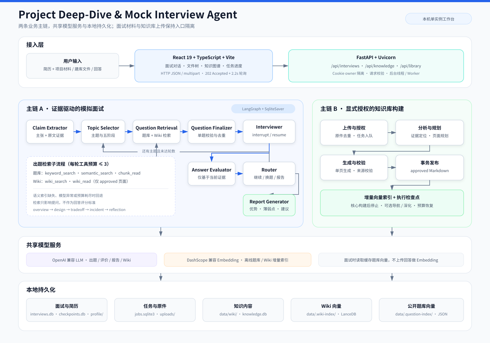

# Project Deep-Dive & Mock Interview Agent

面向技术求职的**项目经历深挖与模拟面试工作台**：读取简历和项目材料，提取带原文证据的技术主张，围绕真实经历进行多轮追问，并生成可解释的面试反馈。


> **当前定位**：本机单实例学习与项目复盘工具，不是公网多用户 SaaS。默认界面为 React + FastAPI；面试记录、图检查点和知识任务使用本地 SQLite 持久化。Web 面试的真实跨进程恢复仍需补充重启回归验证，暂不作为稳定能力承诺。

## 为什么做这个项目

普通题库擅长检查“八股”，却很难验证候选人是否真正理解简历中的设计。这个项目把面试问题锚定到候选人自己的材料：

- **有据可问**：从技术主张和原文证据出发，而不是只按技术名词随机出题。
- **持续深挖**：按项目总览、设计、取舍、故障、复盘五个阶段组织追问。
- **评价可解释**：评价只使用当前主张、证据、问题和回答，不把通用知识当作候选人事实。
- **知识可沉淀**：通过独立、显式授权的建库入口，把资料整理为可浏览、可关联、可检索的 Markdown 知识库。

## 核心能力

| 能力 | 当前实现 |
| --- | --- |
| 材料解析 | 支持 MD、PDF、DOCX；Windows 上可通过本机 Word 读取旧版 DOC |
| 主张提取 | 最多提取 8 条技术主张，并保留可逐字核验的原文证据 |
| 多轮面试 | LangGraph 状态图、`interrupt/resume`、主题切换、轮数上限和报告生成 |
| 分层题库 | 45 道原创参考题，覆盖 5 个面试阶段；只辅助出题，不提供标准答案 |
| 检索增强出题 | 题库关键词/缓存语义/题目读取，加上已发布 Wiki 的搜索与读取 |
| 知识工作台 | 文件树、Markdown 预览、知识图谱、任务进度、执行记录与预算恢复 |
| 本地持久化 | 面试 SQLite、图检查点、简历版本、任务原件、Markdown Vault、LanceDB 索引 |
| 可观测性 | 节点耗时、模型调用与 token 用量；知识任务保留阶段和页面级执行记录 |

## 系统架构



架构分为两条业务主链，共享模型服务和本地存储，但上传入口彼此独立：

1. **模拟面试**：简历与项目材料只进入本场面试，不自动进入知识库。
2. **知识库构建**：只有在“拓展现有知识库”入口选择文件后，才授权后台执行解析、模型分析和索引。

### 面试主链

```text
材料解析 → 主张提取 → 主题选择 → 检索出题 → 单题校验
                                              ↓
报告生成 ← 路由判断 ← 回答评价 ← interrupt/resume
    ↑                                      │
    └──── 已达轮数或无更多主题              └──── 继续追问 / 切换主题
```

当前图包含 7 个业务节点：`claim_extractor`、`topic_selector`、`question_retrieval`、`question_finalizer`、`interviewer`、`answer_evaluator`、`report_generator`。

题库 A-RAG 提供 `keyword_search`、`semantic_search`、`chunk_read`；Wiki 另提供 `wiki_search`、`wiki_read`。每轮最多执行 3 次检索工具，语义索引缺失、模型异常或预算耗尽时会使用本地候选和固定问题回退。

**边界**：检索结果只影响提问；评分不检索完整项目材料，也不把 Wiki 内容当作候选人的项目事实。

### 知识库主链

```text
显式上传与授权 → 原件去重 / 任务入队 → 分段分析与证据定位
→ 页面规划 → 单页生成与校验 → 事务发布 → 增量向量索引
```

核心阶段完成后停止，不会自动继续导航整理或深化。后续阶段、复制文件补链和弱引用写入分别需要明确操作；失败任务可从检查点恢复，并受模型调用、token、耗时和页数预算约束。

## 快速开始

### 环境要求

- Windows / PowerShell（默认启动脚本）
- Python 3.12 与 [uv](https://docs.astral.sh/uv/)
- Node.js `^20.19.0` 或 `>=22.12.0`
- 一个 OpenAI 兼容的 LLM 服务；语义索引另需 DashScope 兼容 Embedding 服务

以下命令均在 `mock-interview-agent` 目录执行。

### 1. 安装 Python 依赖

父级虚拟环境不存在时先创建：

```powershell
uv venv ..\.venv
uv pip install --python "..\.venv\Scripts\python.exe" -r requirements.txt
```

启动脚本也支持项目内 `.venv`；独立部署时相应调整下面的解释器路径。

### 2. 配置模型

复制 `src/.env.example` 为 `src/.env`，至少填写：

```dotenv
LLM_MODEL=your-model
LLM_API_KEY=your-api-key
LLM_BASE_URL=https://your-openai-compatible-endpoint/v1
```

`src/.env` 已被 Git 忽略，不要提交真实密钥。完整配置见下文[环境变量](#环境变量)。

### 3. 启动工作台

```powershell
.\scripts\start_workbench.ps1
```

脚本会定位 Python 环境、安装或构建前端，并启动仅监听本机的 FastAPI 服务。访问：

```text
http://127.0.0.1:8501
```

常用参数：

| 命令 | 用途 |
| --- | --- |
| `.\scripts\start_workbench.ps1 -SkipBuild` | 复用已有 `frontend/dist`，跳过前端构建 |
| `.\scripts\start_workbench.ps1 -Port 8502` | 修改监听端口 |
| `.\scripts\start_workbench.ps1 -NoProxy` | 不自动设置 `NO_PROXY` |

PowerShell 禁止执行脚本时：

```powershell
powershell -ExecutionPolicy Bypass -File ".\scripts\start_workbench.ps1" -SkipBuild
```

### 4. 可选：构建题库语义索引

首次使用语义检索，或题库、Embedding 模型变化后执行：

```powershell
& "..\.venv\Scripts\python.exe" scripts/build_question_index.py
```

索引写入 `data/.question-index/`。面试过程只读取缓存向量；没有索引时仍可降级使用关键词检索和参考题。

## 使用流程

1. 在“新建面试”中上传一份简历和一份项目材料，设置 1–8 轮。
2. 等待材料解析与首题生成；页面通过轮询更新，不使用 WebSocket 或 token 流式输出。
3. 回答问题后查看评价，系统根据覆盖情况继续追问、切换主题或生成报告。
4. 如需建设知识库，单独打开“拓展现有知识库”并选择文件；选择即授权本次模型与索引调用。
5. 在文件树、知识图谱和任务通知中查看发布内容、关联与执行记录。

上传限制：单文件 8 MB、PDF 最多 30 页、面试合并材料最多 120,000 字符。扫描 PDF 暂不支持 OCR；DOC 依赖 Windows、本机 Microsoft Word 与 `pywin32`。

## 项目结构

```text
mock-interview-agent/
├── frontend/                    # React + TypeScript 工作台
│   └── src/
│       ├── App.tsx              # 面试、上传与文件浏览主界面
│       ├── KnowledgeActivity.tsx# 阶段任务、补链与确认操作
│       ├── KnowledgeGraph.tsx   # 知识图谱
│       └── ExecutionDetails.tsx # 执行记录与预算恢复
├── src/
│   ├── api_server.py            # FastAPI 入口与资源 owner 隔离
│   ├── interview_graph.py       # LangGraph 节点与路由装配
│   ├── interview_session.py     # invoke / resume / checkpoint 适配
│   ├── interview_store.py       # 面试会话、消息与事件持久化
│   ├── claim_extractor.py       # 技术主张与证据提取
│   ├── topic_selector.py        # 主题和五阶段推进
│   ├── question_retrieval*.py   # 题库与 Wiki 检索 Agent
│   ├── interviewer.py           # interrupt / resume 节点
│   ├── answer_evaluator.py      # 基于当前证据的回答评价
│   ├── report_generator.py      # 面试总结与学习建议
│   ├── document_loader.py       # MD / PDF / DOCX / DOC 解析
│   ├── wiki_intake.py           # 知识分析、生成、发布与恢复主流程
│   ├── wiki_automatic.py        # 后台核心构建 Worker
│   ├── wiki_publish.py          # 多文件事务发布与回滚
│   ├── wiki_index.py            # LanceDB 增量索引
│   └── knowledge_metadata.py    # 页状态、来源与关系元数据
├── scripts/
│   ├── start_workbench.ps1      # 默认启动器
│   ├── build_question_index.py  # 公开题库向量构建
│   └── benchmark_questioning.py # 显式 --live 的公开样本测速
├── tests/                       # 离线回归与手动模型冒烟测试
├── eval/                        # 独立评测与 Langfuse 工程
├── data/
│   ├── question_bank.json       # 45 道公开参考题
│   ├── sample_project.md        # 公开示例材料
│   ├── wiki/                    # Obsidian 兼容 Markdown Vault
│   └── private/                 # 私有运行数据，Git 忽略
└── docs/                        # 架构、流程、评测与工程记录
```

## 数据与持久化

| 数据 | 默认位置 |
| --- | --- |
| 面试会话、消息与事件 | `data/private/wiki-ingest/interviews.db` |
| LangGraph 检查点 | `data/private/wiki-ingest/checkpoints.db` |
| 简历原件与解析文本 | `data/private/wiki-ingest/profile/` |
| 知识任务与执行记录 | `data/private/wiki-ingest/jobs.sqlite3` |
| 建库上传原件 | `data/private/wiki-ingest/uploads/` |
| 知识页元数据 | `data/private/knowledge.db` |
| 已发布知识页 | `data/wiki/` |
| Wiki 向量索引 | `data/.wiki-index/` |
| 公开题库向量 | `data/.question-index/` |

“面试附件不入知识库”不等于“不保存”：简历与面试状态会写入上述本地私有目录。请勿提交真实简历、API Key 或运行数据库。

## 环境变量

| 变量 | 用途 / 默认值 |
| --- | --- |
| `LLM_MODEL` / `LLM_API_KEY` / `LLM_BASE_URL` | 面试与 Wiki 的 OpenAI 兼容模型配置 |
| `LLM_THINKING_MODE` | 默认 `disabled`；仅对官方 DeepSeek 地址附加对应参数 |
| `DASHSCOPE_API_KEY` | 构建题库向量、更新 Wiki 向量时使用 |
| `EMBEDDING_MODEL` | 默认 `text-embedding-v4` |
| `EMBEDDING_BASE_URL` | DashScope 兼容 Embedding 地址 |
| `WIKI_MAX_MODEL_CALLS` | 单任务模型调用预算，默认 64 |
| `WIKI_MAX_TOKENS` | 已报告 token 预算，默认 100000；不是绝对计费保证 |
| `WIKI_MAX_ACTIVE_SECONDS` | 单任务累计活动耗时，默认 600 秒 |
| `WIKI_MAX_PAGES` | 单任务页面预算，默认 24 |
| `WIKI_CONCURRENCY` | 分段和页面生成并发，默认 3 |
| `WIKI_REQUEST_ATTEMPTS` | 单次逻辑请求的网络尝试次数，默认 2 |
| `NO_PROXY` / `no_proxy` | 启动脚本默认配置，用于绕过本机代理 |

## 测试与评测

离线 Python 回归不需要 API Key，使用假模型验证图路由、接口契约、发布事务、增量索引和任务恢复：

```powershell
& "..\.venv\Scripts\python.exe" -m unittest discover -s tests -p "test_*.py" -v
```

前端类型检查与生产构建：

```powershell
Push-Location frontend
npm.cmd ci
npm.cmd run build
Pop-Location
```

`tests/smoke_test_*.py` 是手动冒烟测试，其中部分会调用真实模型并产生费用，不属于默认离线回归。`eval/` 提供独立的分阶段评测入口；确定性测试与真实模型评测应分开解读。

## 降级与边界

| 场景 | 行为或限制 |
| --- | --- |
| 题库向量未构建或指纹失效 | 语义工具不可用，回退到关键词、题目读取与本地候选 |
| 检索模型异常、非法输出或预算耗尽 | 使用已见参考题或当前阶段候选，不阻断整场面试 |
| Wiki 向量不可用 | 仍尝试已发布 Markdown 的关键词召回 |
| 回答评分 | 使用当前主张及其证据，不是完整材料向量 RAG |
| 自动知识发布 | 包含结构、来源与版本校验，不等于人工事实审核 |
| 多用户与鉴权 | Cookie owner 用于本机资源隔离，不是账号认证体系 |
| Web 会话恢复 | 已有 SQLite 会话和检查点实现；真实跨进程恢复仍需专项回归 |
| 质量结论 | 离线测试证明状态与契约，不证明真实模型出题质量、检索采用率或成本 |

## 排查与文档

- 模型请求出现 `SSL: UNEXPECTED_EOF_WHILE_READING`：检查 Windows 代理，并为模型和 Embedding 域名设置 `NO_PROXY`。
- 知识页已发布但索引失败：查看任务执行记录，确认 Embedding 服务状态后恢复；无需重新生成知识页。
- 任务提示达到预算：在执行详情中明确提高预算并从检查点继续，已消费计数不会清零。

进一步阅读：[Web 工作台](docs/web-workbench.md) · [知识库流程](docs/wiki-intake.md) · [知识图谱工作流](docs/knowledge-graph-workflows.md) · [执行与恢复](docs/wiki-execution-recovery.md) · [缺陷登记册](docs/engineering/defect-register.md)

> 文档中的早期设计记录可能保留历史状态；当前能力与限制以源码、本 README 和最新缺陷记录为准。
