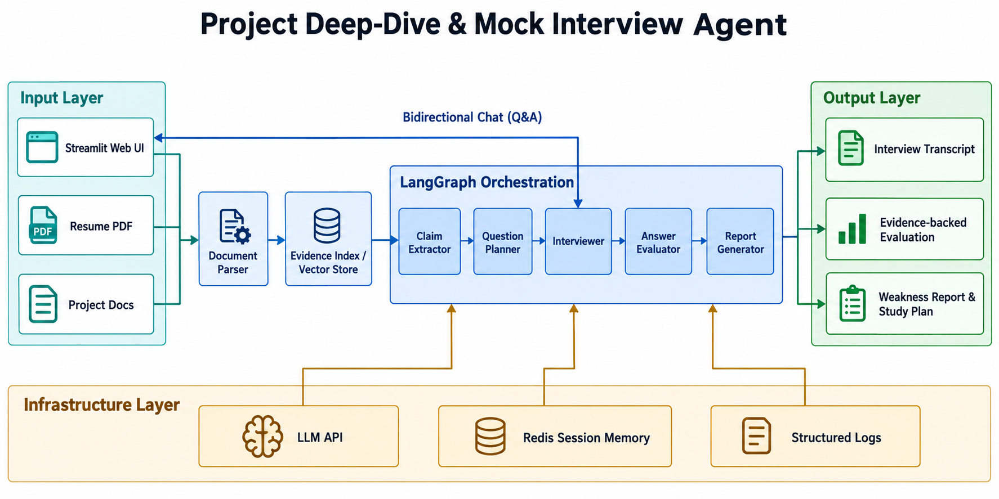

# Project Deep-Dive & Mock Interview Agent

一个为解决面试焦虑而开发的面向特定求职场景的项目经历深挖与模拟面试 Agent。

它接收用户的简历和项目材料，提取其中可验证的技术主张，围绕真实项目经历进行多轮追问，并最终生成基于证据的面试评估与学习建议。

> 当前状态：本机可运行的浏览器版 MVP。面试出题已改为分层参考题库与 A-RAG 三工具检索；跨重启持久化尚未实现。

## 1. 项目背景

在准备技术面试时，普通题库通常只能随机抽取“八股题”，很难围绕候选人真实做过的项目持续深挖。

例如，候选人在简历中写了“使用 Redis SessionStore 保存会话，并通过 TTL 处理过期”，面试官更关心的是：

- Session 续期如何实现？
- 多用户如何避免串话？
- Redis 宕机或会话失效时如何降级？
- 这个设计在多实例部署下是否仍然成立？

本项目希望构建一个能够读取简历和简历中项目材料、根据材料证据进行追问的模拟面试 Agent。它不只问“你会不会”，更关注“你是否真的理解自己写在项目里的内容”。

## 2. 核心目标

- 基于简历和项目材料生成有针对性的项目深挖问题。
- 在多轮对话中记住上下文，像真实面试官一样持续追问。
- 将用户回答与项目材料中的证据进行对照。
- 输出可解释的面试报告，包括掌握较好的技术点、薄弱点和后续学习建议。
- 避免泛化题库式问答，让问题尽可能来自用户自己的项目经历。

## 3. 目标用户

- 广大求职者。
- 想进行项目复盘和技术面试训练的开发者。
- 希望从真实项目材料中发现知识盲区的学习者。

## 4. 目标工作流

```text
简历 PDF / 项目 README / 设计文档
                ↓
           文档解析与切分
                ↓
        技术主张提取与证据索引
                ↓
       LangGraph 多节点面试工作流
                ↓
技术点规划 → 多轮追问 → 回答评估 → 报告生成
                ↓
      面试记录 / 薄弱点 / 学习计划

```

工作流程概念图：


## 开发与测试

当前默认界面为 React + TypeScript 工作台，由 FastAPI 连接现有 Python 面试与 Wiki 链路；旧 Streamlit 页面与终端版保留兼容。开发计划与待办见 [开发进度记录](docs/development-plan.md)。

### 分层题库与检索模式

- 项目自带 45 道原创面试参考题，按项目总览、设计、取舍、故障、复盘五个阶段组织。首次从项目职责和主链路切入，后续跟随上一轮回答追问；答充分则换未覆盖的技术主题。
- 每轮检索 Agent 可使用本地 `keyword_search`、从缓存向量计算的 `semantic_search` 和 `chunk_read`，最多调用三次检索工具。参考题只供出题；评分继续依据上传的项目材料与用户回答。
- 第一次开启语义检索之前，先在 `src/.env` 另行配置 `DASHSCOPE_API_KEY`，从项目根目录**手动构建一次公开题库索引**：

```powershell
& "..\.venv\Scripts\python.exe" scripts/build_question_index.py
```

百炼向量模型默认 `text-embedding-v4`，使用北京地域兼容接口和 1024 维向量。索引写入被 Git 忽略的 `data/.question-index/`；题库或模型版本变化后需重新运行上面的命令。构建时只发送公开题库文本及受控标签，不发送上传的简历或回答；面试时使用预先缓存的受控标签向量，不调用百炼上传用户原文。没有百炼 Key 或索引时，页面会明确提示，并降级使用关键词与参考题，不应将此状态称为三工具齐备的 A-RAG。

当模型服务使用官方 DeepSeek 地址时，结构化出题默认关闭思考模式以降低等待；如需回到原行为，可在 `src/.env` 设置 `LLM_THINKING_MODE=enabled`。其他兼容模型服务不会被附加这个参数。

公开样本的一次性对比：旧链路首题约 19.8 秒、143 字；本次新链路首题约 7.1 秒、31 字；一轮回答后的追问约 2.9 秒。这些只是少量运行样例，**新链路测试时百炼索引未配置**，提速主要与关闭模型思考及压缩主张输出有关，不能将数字归因于完整语义 A-RAG，也不构成性能保证。阶段耗时、调用次数和 token 用量可在页面侧栏查看；日志不打印简历正文。

如需自己测量，仅使用仓库公开的 `sample_project.md`，需显式确认这次模型调用会产生费用：

```powershell
& "..\.venv\Scripts\python.exe" scripts/benchmark_questioning.py --live
```

面试题是否自然、相关、单一，需要按 [人工验收清单](docs/question-quality-checklist.md) 复查；离线单元测试不能替代真实面试体验。

### 启动浏览器版

本工作区将 Python 环境放在上级 `agentLoop/.venv`；在本项目根目录执行：

```powershell
uv pip install --python "..\.venv\Scripts\python.exe" -r requirements.txt
.\scripts\start_workbench.ps1
```

如果尚未配置模型服务，请先参考 `src/.env.example` 创建 `src/.env`，填写 `LLM_MODEL`、`LLM_API_KEY` 和 `LLM_BASE_URL`。已有配置不需要覆盖。页面会分别要求上传一份简历和一份项目材料，支持 PDF、MD、DOC、DOCX；可选面试轮数，完成后展示逐轮反馈和最终报告。

页面默认只监听本机地址，单份文件最多 8 MB。文件不写入仓库，但提取的文字会发送给你配置的模型服务。当前 `InMemorySaver` 仅保留进程内的检查点；关闭浏览器会话或重启服务后，无法恢复原面试。旧版 DOC 仍需本机 Microsoft Word，扫描 PDF 暂不支持 OCR。

在 `mock-interview-agent` 目录执行离线回归测试（无需 API Key，不发送模型请求）：

```powershell
..\.venv\Scripts\python.exe -m unittest discover -s tests -p 'test_*.py' -v
```

`tests/smoke_test_*.py` 为手动冒烟测试；其中 Claim Extractor 和 Answer Evaluator 的测试会调用真实模型，需要先配置对应的环境变量。不要把真实密钥提交到仓库。

### 文档加载器

`src/document_loader.py` 支持 `.md`、`.pdf`、`.docx` 和旧版 `.doc`。克隆仓库后，在当前 Python 环境安装本仓库依赖：

```powershell
uv pip install --python "..\.venv\Scripts\python.exe" -r requirements.txt
```

从项目根目录加载本地材料：

```python
from pathlib import Path
from src.document_loader import combine_project_text, load_document

materials = [
    load_document(Path("data/sample_project.md")),
    load_document(Path("data/private/my-resume.pdf")),
]
project_text = combine_project_text(materials)
```

上传界面调用 `load_uploaded_document(uploaded.name, uploaded.getvalue())`，无需把上传内容保存到项目目录。PDF 需要有可提取的文本层；扫描件暂不支持 OCR。`.doc` 在 Windows 上依赖本机 Microsoft Word 和 `pywin32`，通过独立 Word 进程以只读、禁用宏的方式提取文字；其他系统请先将 `.doc` 转成 `.docx`。文件大小限制为每份 8 MB，PDF 最多 30 页，合并后的材料最多 120,000 字符。私有材料请放入被 `.gitignore` 排除的 `data/private/`，不要提交真实简历。

旧版 `.doc` 的真实打开仍需人工核验：准备一份可放心读取的 `.doc`，在本机执行 `..\.venv\Scripts\python.exe tests/manual_check_legacy_doc.py "你的文件.doc"`。运行时注意 Word 是否出现安全提示、是否正常关闭，以及控制台是否显示非零提取字符数；此脚本不会打印文档正文。

### 面试工作台与显式知识库拓展

界面采用左侧导航/真实知识文件树，通过左侧栏切换模拟面试、文件浏览和知识图谱。文件详情顶部展示基本信息和可点击的来源、关联与反向链接卡片；文件树不再使用来源悬浮提示。选择文件不会编辑知识或推进面试。普通笔记可以浏览，但没有发布标志不会默认索引。

“新建面试”弹窗中的简历与项目材料只用于本场面试，不写入知识库。中央对话区上方的“拓展现有知识库”打开专用建库弹窗：选择并上传文件即授权建库，弹窗自动关闭，右上角通知展示真实进度；后台完成解析、关联、发布和索引。不暴露排队、连接等内部操作选项。通知按红/黄/绿区分待执行、进行中和完成。

原件、任务和授权状态持久化。未授权暂存不会被后台或重启拾取；旧版尚未完成的自动上传任务暂停待明确启动。来源ID、保守合并、失败重试和索引复用机制保留。模型调用可能产生费用，只有明确启动后才发起。

新版启动和界面说明见 [Web 工作台](docs/web-workbench.md)，知识库流程说明见 [工作台与知识库说明](docs/wiki-intake.md)。现有知识页保留，工作台改造不等于已解决A-RAG的Wiki采用率或接入知识评分。

### 知识图谱与阶段化 Wiki 更新

图谱、sources/concepts/entities 核心生成、可选导航/深化阶段，以及复制文件后的授权补链已接入现有工作台。细则见 [知识图谱与分阶段工作流](docs/knowledge-graph-workflows.md)。复制文件只提醒，模型分析与补链写入分别需要确认，不会自动授予检索发布资格。

### Wiki执行记录与局部恢复

生成过程按阶段/页面记录调用、响应结构、耗时和缓存复用。核心任务失败后停在可恢复检查点，不再整批自动重试三轮；在进度详情或知识任务内可查看记录、明确调整预算并恢复。历史任务缺少记录时不估算旧费用。细则见 [执行与恢复](docs/wiki-execution-recovery.md)。
